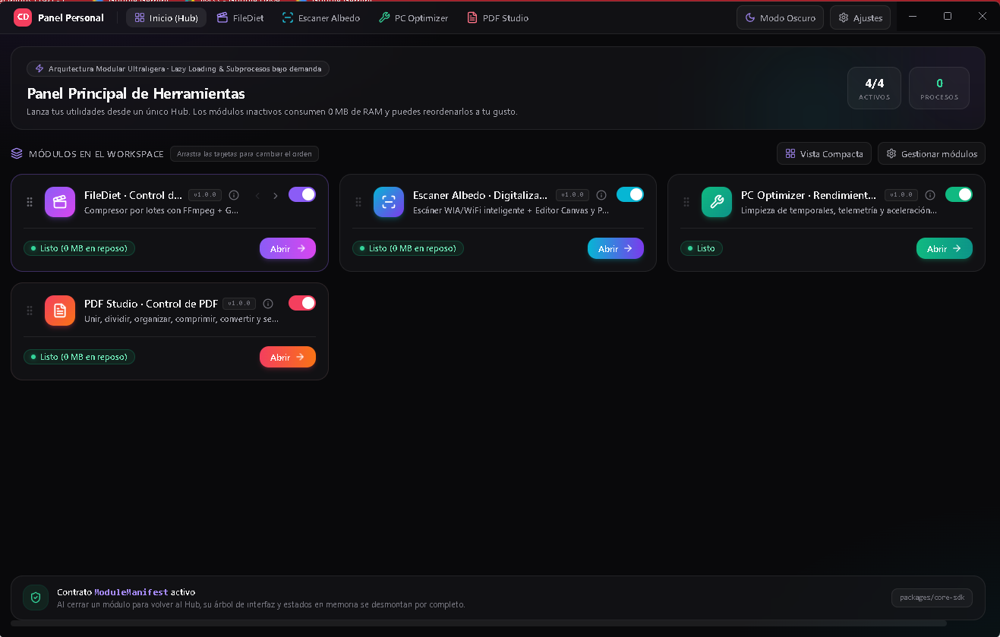
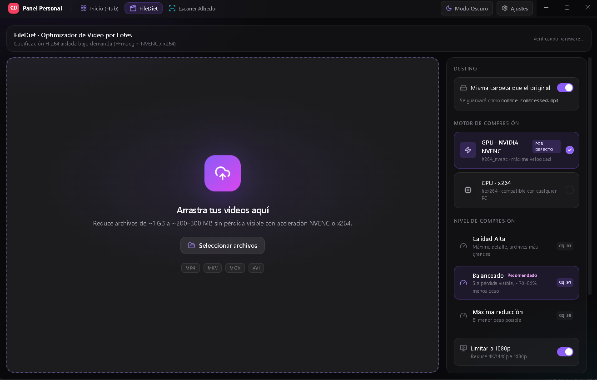
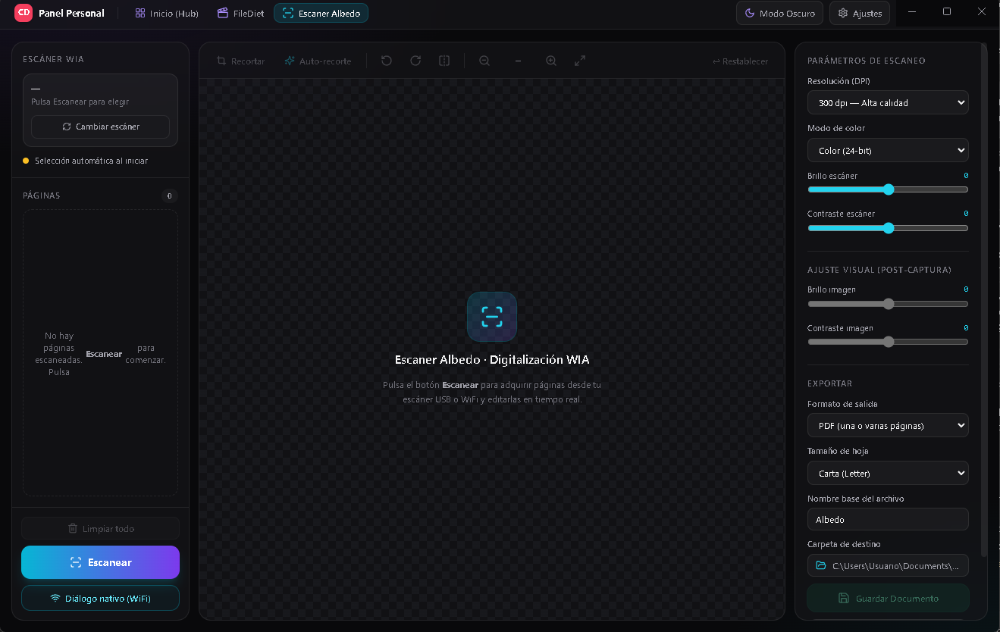
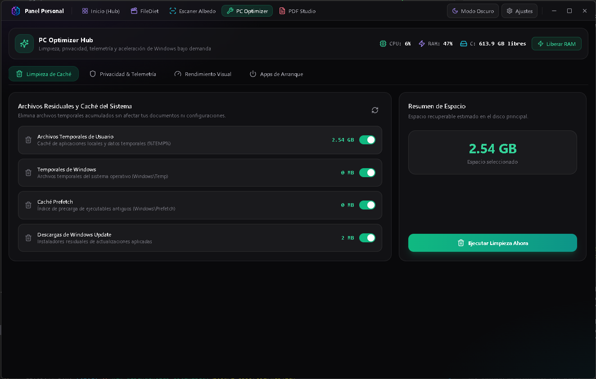
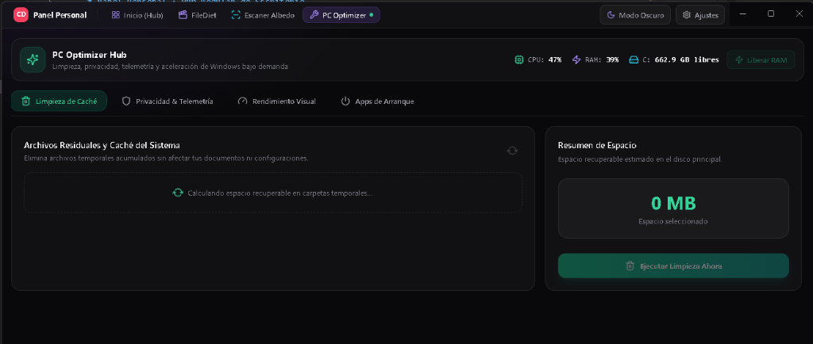
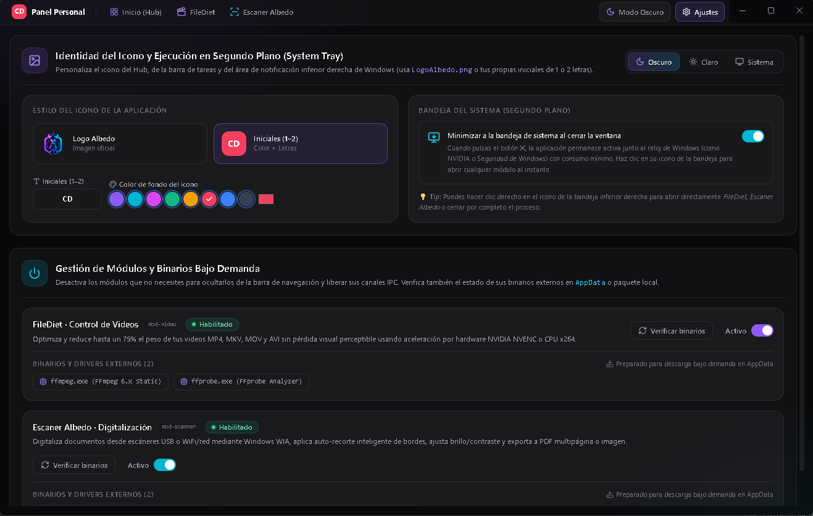

<div align="center">

  

  # Panel Personal · Modular Desktop Hub

  **High-performance desktop utility ecosystem for Windows in the style of PowerToys & Raycast.**  
  Engineered with a modern hybrid architecture using **Tauri v2**, **Rust Cargo Workspaces**, **npm Monorepo**, **comprehensive Lazy Loading**, and **native on-demand subprocesses**.

  [](https://tauri.app/)
  [](https://www.rust-lang.org/)
  [](https://react.dev/)
  [](https://www.typescriptlang.org/)
  [](https://tailwindcss.com/)
  [](https://www.microsoft.com/windows)

  <br />

  <p align="center">
    <a href="#-download--installation">Download Installer</a> •
    <a href="#-screenshots">Screenshots</a> •
    <a href="#-built-in-modules">Modules</a> •
    <a href="#-key-features">Features</a> •
    <a href="#-local-development">Development</a>
  </p>

</div>

---

## 🚀 What's New in Version 2.0 (Tauri v2 & Rust Rewrite)

- **95% Installer Size Reduction:** Decreased from **~163 MB** (Electron) down to just **~6.4 MB** (Tauri v2 + NSIS).
- **Minimal Memory Footprint:** From consuming over 180 MB at idle down to a lean **~15–35 MB of RAM**.
- **Multi-Language Support (i18n):** Full localization in 4 languages: **English**, **Spanish**, **French**, and **Simplified Chinese**, switchable in real time.
- **Custom Frameless Window:** Sleek custom window chrome, including native-feel controls (minimize, maximize/restore, red-highlight close) with smooth dragging via `data-tauri-drag-region`.
- **Native Explorer Drag & Drop:** Native OLE file-drag support in **FileDiet** and **PDF Studio** with immediate disk path resolution and responsive dropzone highlights.
- **Interactive Dashboard Reordering:** Mouse and touch drag-and-drop using *Pointer Events* with drop indicators and quick-shift arrow buttons `[ < ]` / `[ > ]`.
- **Zero Node.js Runtime Dependencies:** Entire backend executes directly as compiled native machine code within Rust binaries.

---

## 📸 Screenshots

<div align="center">

### Main View (Dashboard)
_Central hub featuring real-time system metrics, quick tool launch pads, and active module toggles._



<br />

| FileDiet (Video Compressor) | Albedo Scanner (WIA Digitalization) |
|:---:|:---:|
|  |  |
| _Batch GPU NVENC / CPU x264 compression_ | _WIA/WiFi scanner acquisition + Canvas editor & PDF_ |

<br />

| PC Optimizer (Performance & Privacy) | PDF Studio (Comprehensive PDF Toolkit) |
|:---:|:---:|
|  |  |
| _Deep cache cleaner, telemetry blocking & startup apps_ | _Merge, split, reorder, compress, stamp & secure_ |

<br />

### Settings, Themes & Visual Branding
_System Tray manager, multi-language selector, theme switch (Dark/Light/System), and dynamic identity generator._



</div>

---

## ⚡ Key Features

- **Zero Idle Memory Consumption:** Modules and heavy processing engines are code-split using Dynamic Imports (`React.lazy`) and loaded only when opened. Navigating back to the Hub releases resources immediately.
- **Heavy Task Isolation in Rust:** Intensive processes such as **FFmpeg** encoding and **Windows WIA / PowerShell STA** driver scripts are dispatched asynchronously by native Rust crates without blocking the UI.
- **Global Multi-Language Engine:** Instant locale switching with zero reloads across the dashboard, settings, and all internal module tools.
- **System Tray Integration:** Option to minimize silently to the system tray next to the Windows clock. Single click restores the window; right click opens a quick-launch menu.
- **Custom Visual Identity:** Choose between the official embedded **App Logo** or dynamically generate minimalist **Initials & Custom Accent Colors**, syncing instantly across the titlebar and system tray.
- **Unified Theme System:** First-class support for **Dark Mode**, **Light Mode**, and **System Sync** with native theme change listeners.

---

## 🧩 Built-in Modules

### 🎬 1. FileDiet · Batch Video Optimizer
- Intelligent batch compression for `.mp4`, `.mkv`, `.mov`, and `.avi` formats.
- Native drag-and-drop file detection directly from Windows Explorer.
- Hardware acceleration powered by **NVIDIA NVENC (`h264_nvenc`)** with automatic fallback to **CPU (`libx264`)**.
- Preset profiles (`High Quality`, `Balanced ~75%`, `Maximum Reduction`) and smart 1080p downsampling.
- Sequential job queue to prevent CPU/GPU overload.

### 📄 2. Albedo Scanner · WIA Digitalization
- Direct hardware communication with USB and WiFi/Network scanners via **Windows Image Acquisition (WIA)**.
- Remembers preferred scanning device or triggers the native Windows selection dialog.
- **Built-in Canvas Editor:** Manual cropping, intelligent blank-border auto-crop, 90° rotation, horizontal flip, and brightness/contrast adjustments.
- Multi-format export: Single/multi-page **PDF** (Letter / A4) or individual image pages (`.png` / `.jpg`).

### ⚡ 3. PC Optimizer · Performance & Privacy
- Deep cleaning of user temporary files (`%TEMP%`), Windows system temp, Prefetch cache, and leftover Windows Update downloads.
- Disables invasive telemetry and diagnostic logs (`DiagTrack`, Advertising ID, Feedback prompts).
- Streamlines desktop animations and translucency for maximum UI responsiveness.
- Inspects and manages startup registry keys (`Run` keys) and offers one-click RAM trimming.

### 📕 4. PDF Studio · Comprehensive Document Toolkit
- Native drag-and-drop file ingestion with reactive glow feedback.
- **Merge PDF:** High-speed batch merging with interactive reordering and instant thumbnail previews.
- **Split & Extract:** Extract custom ranges (`1-4, 7`), visual page-by-page grid selection, or split every page into separate files.
- **Organize & Rotate:** Sharp in-memory page previews (`pdfjs-dist/legacy`), 90° free rotation, and inserting additional documents.
- **Compress & Optimize:** 3 compression tiers (Lossless Structural, Balanced 150 DPI, Maximum 100 DPI) with live file-size calculation.
- **Convert & Stamp:** Image-to-PDF conversion, PDF-to-image extraction, page numbering stamps, watermarks, and AES password protection.

---

## 🏛️ Monorepo Structure

```text
PanelPersonal/
├── Cargo.toml                       # Root Cargo Workspace (Rust orchestrator)
├── package.json                     # Root npm Monorepo Workspaces
├── LogoAlbedo.png                   # Official master suite branding asset
├── release/                         # Production NSIS installers
│   └── Panel Personal Hub Setup 2.0.0.exe
│
├── apps/
│   └── hub-principal/               # Main Host Application (@panel/hub)
│       ├── src-tauri/               # Native Tauri v2 + Rust host
│       │   ├── Cargo.toml
│       │   ├── tauri.conf.json      # Window, NSIS, and icon configurations
│       │   ├── icons/               # Multi-resolution icon set (.ico, .png)
│       │   └── src/lib.rs           # IPC commands, System Tray & window lifecycle
│       └── src/
│           └── renderer/            # Dashboard, Settings & Navigation (React + Vite)
│
├── packages/
│   ├── core-sdk/                    # Shared types, IPC bridges & module manifests
│   └── ui-kit/                      # Design tokens, ThemeProvider, i18n & primitives
│
└── modules/                         # Hybrid Modules (Rust Crates + React UI)
    ├── mod-video/                   # FileDiet: Native mod_video crate + React UI
    ├── mod-scanner/                 # Albedo Scanner: Native mod_scanner crate + Canvas UI
    ├── mod-optimizer/               # PC Optimizer: Native mod_optimizer crate + React UI
    └── mod-pdf/                     # PDF Studio: Native mod_pdf crate + pdf-lib/pdfjs UI
```

---

## 📦 Download & Installation

Precompiled x64 installers for Windows are officially distributed through **GitHub Releases**:

| Distribution | File | Size | Link |
|:---|:---|:---|:---|
| **Official NSIS Setup** | `Panel Personal Hub Setup 2.0.0.exe` | **~6.4 MB** | [⬇️ Download from Releases](https://github.com/CarloYoli06/PersonalPanel/releases) |

> 💡 **Note**: To build your own standalone installer locally, execute `npm run dist`. The compiled installer will be generated inside the `release/` directory.

---

## 🛠️ Local Development

### Requirements
- **Node.js** `>= 18.0.0`
- **npm** `>= 9.0.0`
- **Rust & Cargo** `>= 1.80.0` (Toolchain `stable-x86_64-pc-windows-msvc`)
- **Windows 10 / 11 (x64)**

### Available Scripts

```bash
# 1. Install all monorepo dependencies
npm install

# 2. Launch development environment with Hot-Reload (Vite + Tauri Dev)
npm run dev

# 3. Perform strict TypeScript type checking across the workspace
npm run typecheck

# 4. Compile optimized production binaries and generate the NSIS installer (.exe)
npm run dist
```

---

## ➕ Adding New Modules in the Future

The workspace architecture is designed to scale effortlessly:

1. Create a module folder under `modules/mod-your-tool/` containing its `package.json` and its native Rust crate in `src-rust/`.
2. Register the crate in the workspace root `Cargo.toml`.
3. Implement the `ModuleManifest` contract from `@panel/core-sdk`, lazy loading the UI view via `React.lazy(() => import('./renderer/YourView'))`.
4. Register your manifest in `apps/hub-principal/src/renderer/src/registry.ts`.
5. The module will automatically appear on the Dashboard with on-demand loading, unified themes, drag-and-drop reordering, and enable/disable lifecycle toggles.

---

<div align="center">
  <sub>Engineered with care on an ultra-lightweight modular Tauri v2 architecture for Windows. MIT License.</sub>
</div>
